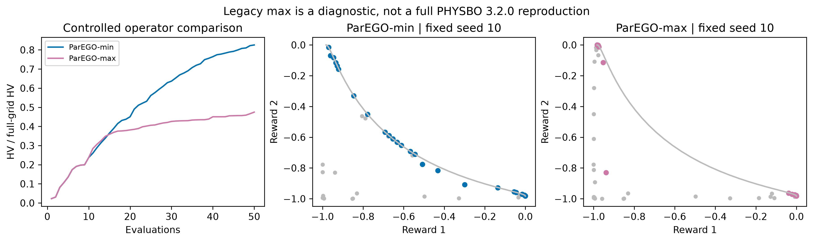
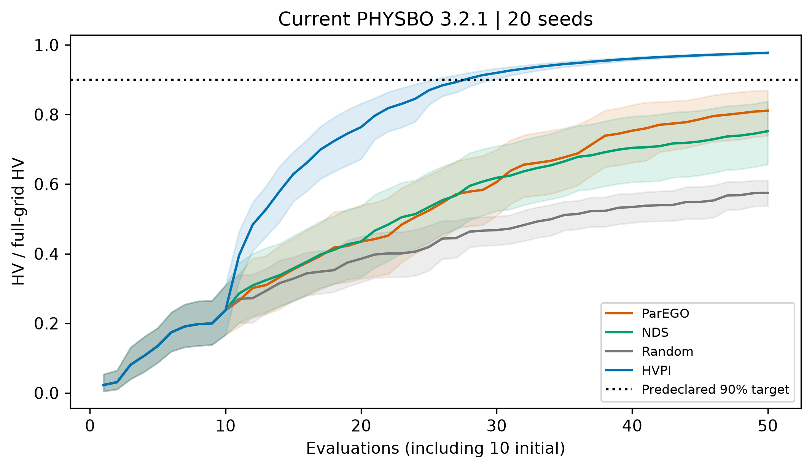

# ParEGO Implementation Fix and Fixed-Budget Performance

[](https://github.com/DannyTheCreator/physbo-parego-fix-study/actions/workflows/check.yml)
[](docs/REPRODUCTION.md)
[](https://github.com/issp-center-dev/PHYSBO/releases/tag/v3.2.1)
[](docs/PROTOCOL.md)
[](LICENSE)

An independent, reproducible study of **PHYSBO 3.2.1** on **VLMOP2**, a synthetic
two-objective optimization task. The repository includes experiment code,
per-evaluation trajectories, statistical summaries, figures, an executed notebook
and a PDF brief. No external task dataset or GPU is required.

**Two questions:** Does the ParEGO implementation correction improve search in a
controlled experiment? How does corrected native ParEGO compare with HVPI, NDS
and Random when each receives the same evaluation budget?

**Main finding:** At 50 evaluations, the corrected operator improves mean raw
hypervolume from **0.1588 to 0.2762** in the controlled comparison. In the separate
native-strategy comparison, **HVPI has the highest observed mean hypervolume**
(0.3270, versus ParEGO's 0.2713). Both findings concern the setup below.

[Full report](docs/REPORT.md) · [PDF brief](output/pdf/physbo_upgrade_report.pdf) ·
[Evidence notebook](notebooks/upgrade_demo.ipynb) · [Reproduction guide](docs/REPRODUCTION.md) ·
[GitHub Actions](https://github.com/DannyTheCreator/physbo-parego-fix-study/actions/workflows/check.yml)

## Why study this correction?

Multiobjective optimization searches for trade-offs: improving one objective may
worsen another. ParEGO combines the observed objectives into a scalar score, then
uses a single-objective Bayesian optimization policy to select the next candidate.
The [official PHYSBO 3.2.1 correction](https://github.com/issp-center-dev/PHYSBO/releases/tag/v3.2.1)
changes the weighted Chebyshev reduction used in that score.

Under this implementation's maximization convention, the corrected score uses a
**minimum** across weighted, scaled objectives. The diagnostic condition replaces
that minimum with a **maximum**, leaving the augmentation term unchanged:

$$
u_{\min}(\tilde{\mathbf y},\mathbf w)
= \min_j(w_j\tilde y_j) + 0.05\sum_j w_j\tilde y_j.
$$

Here the observed objectives are scaled to [-1, 0], the weights sum to one, and
larger scores are preferred. With equal weights, the change reverses the ranking
in this simple example:

| Scaled objective pair | Corrected min score | Diagnostic max score |
| --- | ---: | ---: |
| A = (-1, 0) | -0.525 | -0.025 |
| B = (0, -1) | -0.525 | -0.025 |
| C = (-0.4, -0.4) | -0.220 | -0.220 |

The min score prefers the balanced point C; the max score prefers A or B. This
illustrates the ranking mechanism; the experiments measure its effect on search.
See the [protocol](docs/PROTOCOL.md) and [three-point evidence](results/upgrade/three_points.json).
The official correction and optimization algorithms are upstream PHYSBO work.

## Experimental design

| Setting | Value |
| --- | --- |
| Task | VLMOP2; two analytic objectives, negated for maximization |
| Candidate space | 101 × 101 grid over [-2, 2]²; 10,201 candidates |
| Evaluation budget | 50 per trajectory: 10 initial evaluations + 40 search evaluations |
| Repetitions | 20 seeds (10–29); identical ordered initial candidates within each seed |
| Model | Exact Gaussian process; retraining interval of 10 probes |
| Selection | One new candidate per probe; no repeated queries |
| Primary quality metric | Raw hypervolume (HV) at 50 evaluations; larger is better |
| HV reference / target | Reference (-1, -1); 90% of full-grid HV ≈ 0.301066 |
| Execution | Serial CPU runs; loaded BLAS libraries limited to one thread |

HV measures the area dominated by the observed trade-off solutions relative to
the fixed reference. Full-grid HV is approximately **0.334518**. A “90% target
hit” means a run reaches at least 90% of that fixed-grid value within 50
evaluations. These are dimensionless mathematical objectives. The full-grid
objective values and targets are used only for offline reporting; selection
receives queried objective values only.

| Experiment | Comparison | Trajectories |
| --- | --- | ---: |
| 1. Controlled correction effect | ParEGO-min versus diagnostic ParEGO-max, with paired weight streams | 2 × 20 = 40 |
| 2. Native strategy performance | Corrected ParEGO, HVPI, NDS and Random | 4 × 20 = 80 |

Experiment 1 changes only the reduction inside PHYSBO 3.2.1. It uses an independent,
logged weight stream shared by each min/max pair. Experiment 2 uses native library
strategies: ParEGO scalarization, hypervolume-based probability of improvement
(HVPI), non-dominated sorting (NDS), and a random-search baseline.

**The diagnostic ParEGO-min and native ParEGO have different weight mechanisms.**
Their trajectories are analyzed separately. Experiment 1 isolates an operator
effect; it does not compare complete historical PHYSBO releases. Full settings,
timing boundaries and statistical methods are in the [protocol](docs/PROTOCOL.md).

## Results

### 1. Effect of the implementation correction

| Controlled operator | Mean final raw HV | 95% bootstrap interval |
| --- | ---: | --- |
| Diagnostic ParEGO-max | 0.1588 | [0.1341, 0.1830] |
| Corrected ParEGO-min | 0.2762 | [0.2629, 0.2876] |
| Paired difference: min − max | **0.1174** | **[0.0891, 0.1469]** |

The corrected reduction improves mean final HV in the 20-pair controlled
experiment. Source: [paired comparison](results/upgrade/paired_comparisons.csv)
and [summary data](results/upgrade/summary.csv), at 50 total evaluations.



### 2. Native strategies at the same evaluation cap

| Strategy | Mean final raw HV [95% bootstrap interval] | 90% target hits | Mean cumulative decision time (s) |
| --- | --- | ---: | ---: |
| ParEGO | 0.2713 [0.2472, 0.2910] | 4/20 | 2.718 |
| HVPI | **0.3270 [0.3260, 0.3278]** | **20/20** | 6.948 |
| NDS | 0.2516 [0.2195, 0.2804] | 6/20 | 2.650 |
| Random | 0.1922 [0.1795, 0.2043] | 0/20 | <0.001 |

All rows use 20 seeds and 50 total evaluations. HVPI has the highest observed
mean final quality and reaches the target in all 20 runs. ParEGO's observed mean
exceeds NDS and Random; no pairwise significance test is claimed for this table.
Source: [summary data](results/upgrade/summary.csv) and
[target sensitivity](results/upgrade/target_sensitivity.csv).



Quality intervals use 10,000 percentile seed-bootstrap draws (statistical seed
20261015); the correction difference uses paired resampling. Intervals are
pointwise. Target-hit denominators include every run, including non-hits. The
[full report](docs/REPORT.md) also compares 10/20/50-evaluation checkpoints and
80%/90%/95% targets.

Decision time is measured local computation overhead, including model fitting,
updates and candidate selection. It excludes objective evaluation, logging and
offline reporting. It is hardware dependent; it does not measure physical
experiment duration or establish performance under an equal wall-clock budget.

## Quick start

Use **Python 3.11**. Clone the repository and create a virtual environment:

```bash
git clone https://github.com/DannyTheCreator/physbo-parego-fix-study.git
cd physbo-parego-fix-study
python -m venv .venv
```

Activate the environment in your shell:

```powershell
# Windows PowerShell
.\.venv\Scripts\Activate.ps1
```

```bash
# Linux / macOS
source .venv/bin/activate
```

Install the pinned experiment dependencies and verify the included evidence:

```bash
python -m pip install -r requirements.txt
python scripts/run_upgrade.py --verify-only
python scripts/check_publication.py
```

Verification audits **120 retained trajectories / 6,000 evaluations** and
recomputes the saved statistics, including initialization, unique queries,
objective rewards, scalarization weights and historical repeat evidence. It
performs no optimization. The publication check validates documentation links
and required artifacts. Run all commands from the repository root.

### Run new experiments

```bash
# Small execution: six trajectories, 15 × 15 grid, 14 evaluations each
python scripts/run_upgrade.py --smoke-only --output .cache/two-study-smoke

# Full design: 120 trajectories, 101 × 101 grid, 50 evaluations each
python scripts/run_upgrade.py --full --output .cache/two-study-full

# Compare a fresh full run with retained observations, excluding clocks
python scripts/verify_replay.py --replay .cache/two-study-full --summary .cache/two-study-full/comparison.json
```

Both execution modes run the test suite first, collect trajectories and build
summary outputs. Choose a fresh output directory after changes to code,
dependencies or machine. Smoke checks the pipeline; it does not reproduce the
reported full-design estimates. The two-study manifest is defined in
[`src/upgrade_study.py`](src/upgrade_study.py); the separate `configs/vlmop2*.json`
files belong to the auxiliary multiobjective runner.

### Rebuild figures, notebook and PDF

```bash
python src/upgrade_report.py --results results/upgrade --figure-dir figures/upgrade
python scripts/build_upgrade_demo.py
python -m pip install -r requirements-report.txt
python scripts/build_upgrade_report.py
```

These commands rebuild derived artifacts from retained results. The notebook
executes evidence-reading cells; it does not rerun the optimization campaign.
See [reproduction instructions](docs/REPRODUCTION.md) for repeat checks and resume rules.

## Repository guide

| Path | Purpose |
| --- | --- |
| [`src/upgrade_study.py`](src/upgrade_study.py) | Controlled min/max implementation, native strategies, manifest and execution queue |
| [`scripts/run_upgrade.py`](scripts/run_upgrade.py) | Verify, smoke and full-run entry point |
| [`results/upgrade/`](results/upgrade/) | Active manifest, 120 original run logs, metadata and derived statistics |
| [`figures/upgrade/`](figures/upgrade/) | Both comparisons in PNG and PDF |
| [`notebooks/upgrade_demo.ipynb`](notebooks/upgrade_demo.ipynb) | Executed evidence walkthrough |
| [`docs/REPORT.md`](docs/REPORT.md) | Results, budget checkpoints, target sensitivity and interpretation |
| [`docs/PROTOCOL.md`](docs/PROTOCOL.md) | Experimental controls, metrics, statistics and timing definition |
| [`docs/VALIDATION.md`](docs/VALIDATION.md) | Validation evidence and semantic review status |
| [`evidence/`](evidence/) | Historical repeats, isolated smoke records, validation and review records |
| [`tests/`](tests/) | Regression, orchestration and evidence-integrity checks |

## Validation, scope and provenance

Recorded validation includes **57 passing tests** and a fresh full replay matching
all **120 trajectories / 6,000 evaluations** in candidate sequence, initialization,
rewards and weights. Replay clocks are excluded; the reported original timings
are preserved. The [CI workflow](.github/workflows/check.yml) runs tests, a smoke
campaign, frozen-result verification, publication checks, notebook execution and
PDF rebuilding on Windows and Ubuntu. See [validation](docs/VALIDATION.md) for the
evidence and its limits. The attempted semantic review ended before an overall
verdict; it is **incomplete**, not a review pass.

This study covers one analytic task, one candidate grid, one model configuration
and 20 seeds. It does not establish a universal strategy ranking, superiority on
real materials, or physical synthesis success.

The retained runs were selected from a larger predecessor campaign. This
independent repository preserves their original observations and timestamps;
the scope revision and repository migration did not create new experimental
observations. Earlier version numbers, commit identities and collector snapshots
refer to that predecessor. In particular,
[`results/upgrade/source_snapshot/`](results/upgrade/source_snapshot/) is historical
acquisition provenance; use the current `src/` and protocol for new runs. See
[repository provenance](docs/REPOSITORY_PROVENANCE.md).

## Attribution and citation

PHYSBO maintainers supplied the algorithms and official correction. This project
contributes the controlled experiment, fixed-budget comparison and auditable
reporting; it does not claim discovery or authorship of the upstream fix.
Implementation, analysis and writing were AI-assisted.

- Upstream: [PHYSBO](https://github.com/issp-center-dev/PHYSBO),
  [3.2.1 correction](https://github.com/issp-center-dev/PHYSBO/releases/tag/v3.2.1),
  [update paper (arXiv v1)](https://arxiv.org/html/2603.01349v1).
- When using this study, cite the repository at the commit used, following
  [`CITATION.cff`](CITATION.cff), and cite the upstream PHYSBO work.
- [Attribution details](CONTRIBUTIONS.md) · [Third-party notices](THIRD_PARTY_NOTICES.md) ·
  [Contributing](CONTRIBUTING.md) · [MIT license](LICENSE).
